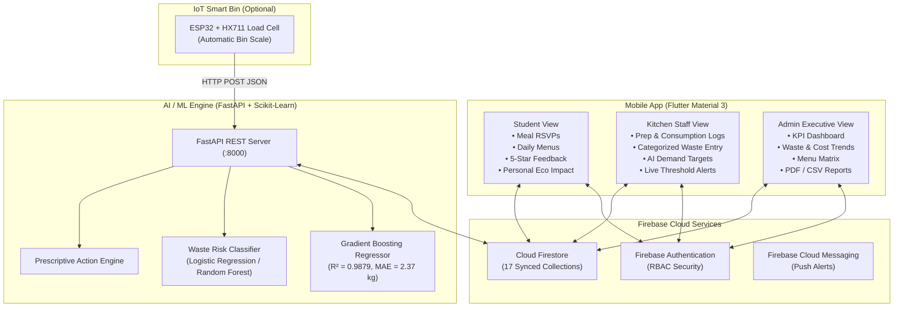

# MealMind – AI-Powered Food Waste Tracking and Prevention System

[](https://www.python.org/)
[](https://fastapi.tiangolo.com/)
[](https://flutter.dev/)
[](https://firebase.google.com/)
[](https://scikit-learn.org/)

MealMind is an intelligent, production-grade mobile and artificial intelligence platform designed to predict institutional food demand, reduce cafeteria overproduction, diagnose root causes of food waste, compute financial losses, and deliver prescriptive recommendations to kitchen and administrative staff.

---

## 🌟 Key Capabilities

1. **Student Meal Intention System (RSVP)**:
   - Students confirm or skip individual meal slots (`Breakfast`, `Lunch`, `Snacks`, `Dinner`).
   - Expected attendance is calculated dynamically ($E = C \times \alpha + \beta$) to guide kitchen preparation.
2. **AI Food Demand Prediction**:
   - Machine Learning regression models (Random Forest, Gradient Boosting with $R^2 = 0.9879$) forecast exact intake quantities.
   - Explainable AI Factor breakdown shows influence of student RSVPs, dish satisfaction ratings, calendar events, and moving average buffers.
3. **Proactive Waste Risk & Threshold Alerts**:
   - Classifies risk (`Low`, `Medium`, `High`) and estimated waste percentage.
   - Instantly triggers color-coded alerts (🟢 Normal, 🟡 Warning, 🔴 Critical) when waste exceeds the configurable threshold (e.g. 15%).
4. **Actionable AI Recommendation Engine**:
   - Prescribes staggered batch preparation, portion ladle recalibration, recipe reformulation for low-scoring dishes, and FIFO inventory checks with projected financial savings.
5. **Strategic 4-Quadrant Menu Matrix**:
   - Classifies menu items into *Stars*, *Workhorses*, *Portion Mismatches*, and *Re-evaluations*.
6. **Financial Loss & Cost Analytics**:
   - Calculates daily, weekly, and monthly monetary losses from food waste and estimates potential institutional savings.
7. **Personal & Campus Sustainability Dashboard**:
   - Tracks estimated $\text{CO}_2\text{e}$ emissions avoided and embedded water footprint saved using documented UNEP/FAO conversion baselines.
8. **Automated Audit Reports (PDF & CSV)**:
   - Generates daily, weekly, and monthly reports ready for download and export.
9. **Optional IoT Smart Bin Integration**:
   - ESP32 + HX711 Load Cell firmware for automatic weight stabilization and cloud transmission.
10. **Role-Based Access Control (RBAC)**:
    - Dedicated flows for **Admin**, **Kitchen Staff**, and **Student**.

---

## 🏗️ System Architecture



---

## 📁 Repository Structure

```
mealmind/
├── mealmind_app/                # Flutter Mobile Application (Material 3)
│   ├── lib/
│   │   ├── core/                # Constants, Theme, Calculations, Formatters
│   │   ├── data/
│   │   │   ├── models/          # 11 Data models (User, Menu, Prep, Waste, etc.)
│   │   │   └── services/        # Auth, Firestore, ML Client, Demo Data, Export
│   │   ├── providers/           # State management (Auth, Meal, Waste, Pred, etc.)
│   │   ├── presentation/
│   │   │   ├── common/          # Splash, Login, Register, Forgot Password
│   │   │   ├── student/         # 8 Student screens (Dashboard, RSVP, Impact, etc.)
│   │   │   ├── staff/           # 10 Kitchen staff screens (Prep, Waste, Alerts, etc.)
│   │   │   └── admin/           # 11 Admin screens (KPIs, Cost, Matrix, Reports)
│   │   └── widgets/             # Charts, KPI cards, Waste badges, Star ratings
│   ├── test/                    # Automated calculations & model unit tests
│   └── pubspec.yaml
│
├── mealmind_ml/                 # Python AI/ML Engine & Microservice
│   ├── data_generator.py        # Synthetic dataset generator (1,700+ rows, 90 days)
│   ├── train_models.py          # Model training, comparison & serialization
│   ├── predictor.py             # Explainable inference engine
│   ├── recommendation_engine.py # Actionable recommendations & Menu matrix
│   ├── app.py                   # FastAPI REST server
│   ├── test_ml.py               # Pytest automated test suite (8 test cases)
│   ├── requirements.txt
│   └── models/                  # Serialized .joblib models & metrics JSON
│
├── mealmind_iot/                # Smart Scale Hardware Integration
│   ├── smart_scale.ino          # ESP32 + HX711 Load cell Arduino sketch
│   └── README.md                # Circuit schematic, pinout, and calibration guide
│
├── firebase/                    # Firebase Configuration
│   ├── firestore.rules          # Strict RBAC security rules for 17 collections
│   ├── firestore.indexes.json   # Composite analytical query indexes
│   └── firebase.json
│
└── docs/                        # Complete Documentation Suite
    ├── README.md
    ├── ARCHITECTURE.md
    ├── SCHEMA.md
    ├── API.md
    ├── TESTING.md
    ├── PROJECT_REPORT.md
    └── PRESENTATION.md
```

---

## 🚀 Quickstart Guide

### 1. Python ML Backend Setup

```bash
# Navigate to ML directory
cd mealmind_ml

# Install dependencies
pip install -r requirements.txt

# Generate historical dataset & train models
python data_generator.py
python train_models.py

# Run test suite
python -m pytest test_ml.py -v

# Start FastAPI server
python app.py
# Server will run on http://127.0.0.1:8000 (Swagger docs at /docs)
```

### 2. Flutter Mobile App Setup

```bash
# Navigate to App directory
cd mealmind_app

# Fetch Flutter dependencies
flutter pub get

# Run on Android emulator / connected device
flutter run
```

> [!TIP]
> **Zero-Friction Demo Mode**: The application includes a pre-loaded simulation of "ABC College" (500+ student profiles, 30 days of historical prep/waste records, live active menus). You can instantly switch between **Student**, **Kitchen Staff**, and **Admin** perspectives directly from the Login screen or Profile drawer!

---

## 📊 Evaluation & Machine Learning Performance

| Task | Candidate Model | Evaluation Metric | Selected Champion |
| :--- | :--- | :--- | :--- |
| **Demand Forecasting** | Linear Regression | MAE: 4.30 kg, $R^2$: 0.9567 | |
| **Demand Forecasting** | Random Forest Regressor | MAE: 2.48 kg, $R^2$: 0.9819 | |
| **Demand Forecasting** | **Gradient Boosting Regressor** | **MAE: 2.37 kg, $R^2$: 0.9879** | 🏆 **Champion** |
| **Waste Risk Class.** | **Logistic Regression** | **Accuracy: 80.7%, F1: 0.7374** | 🏆 **Champion** |
| **Waste Risk Class.** | Random Forest Classifier | Accuracy: 80.1%, F1: 0.7209 | |

---

## 📄 License & Attribution
Developed with ❤️ by the MealMind Engineering Team.
All environmental calculations reference documented scientific conversion baselines (UNEP & FAO Food Waste Index).
