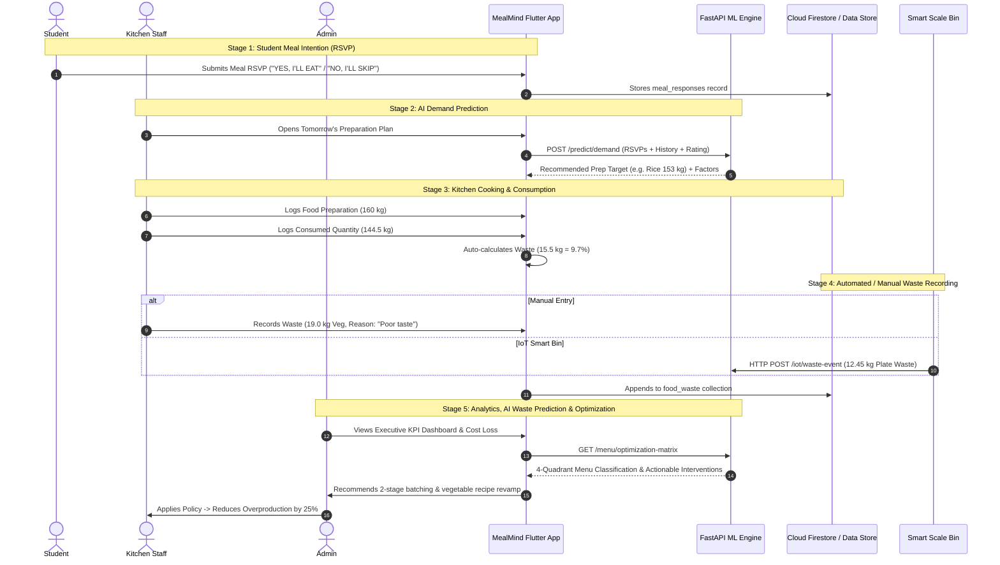

# MealMind: System Architecture Document

## 1. Architectural Overview

MealMind is architected using a decoupled **Clean Architecture** and **Microservice-assisted Mobile Client** model. It provides high resilience through a **Hybrid Prediction Pipeline**: the client consumes high-accuracy Gradient Boosting regression forecasts from the Python FastAPI server when online, and smoothly falls back to a deterministic heuristic model with explainability factors if operating in low-connectivity kitchen environments.

---

## 2. End-to-End Operational Lifecycle

The system enforces a closed-loop food waste tracking and prevention lifecycle:



---

## 3. Layered Mobile Architecture (Flutter)

```
+-------------------------------------------------------------------------+
|                         PRESENTATION LAYER                              |
|  - Common: Splash, Login (Quick Switcher), Register, Password Reset     |
|  - Student: Dashboard, Menu View, RSVP Toggle, 5-Star Feedback, Impact  |
|  - Kitchen Staff: Prep Log, Consumption Calc, Waste Entry, Predictions   |
|  - Admin: Executive KPIs, Trend Charts, Cost Loss, Reports, Settings    |
+-------------------------------------------------------------------------+
                                    |
                                    v
+-------------------------------------------------------------------------+
|                     STATE MANAGEMENT / PROVIDERS                        |
|  - AuthProvider        - MealProvider          - WasteProvider         |
|  - PredictionProvider  - AnalyticsProvider     - SettingsProvider      |
+-------------------------------------------------------------------------+
                                    |
                                    v
+-------------------------------------------------------------------------+
|                           DOMAIN / CORE                                 |
|  - Calculations (Waste Qty, Waste %, Financial Cost, Savings, RSVP Ext) |
|  - Formatters (Currency, Weight, Dates)                                 |
|  - Environmental Baselines (2.5 kg CO2e/kg, 1,000 L water/kg)           |
|  - Theme & Design Tokens (Forest Green Material 3 Palette)              |
+-------------------------------------------------------------------------+
                                    |
                                    v
+-------------------------------------------------------------------------+
|                        DATA & SERVICES LAYER                            |
|  - FirestoreService (17 collections synchronized)                       |
|  - MLApiService (FastAPI client + deterministic offline predictor)      |
|  - DemoDataService ("ABC College" 500+ student historical simulations)   |
|  - ReportExportService (CSV and PDF document generators)                |
|  - NotificationService (FCM and In-App Alert Dispatcher)                |
+-------------------------------------------------------------------------+
```

---

## 4. Machine Learning Pipeline Architecture

The Python backend trains on 1,700+ synthetic historical cafeteria session records containing 22 features.

### Feature Pipeline:
- **Categorical Features**: `day_of_week`, `meal_type`, `food_item` $\rightarrow$ Processed via `OneHotEncoder(handle_unknown='ignore')`.
- **Numerical Features**: `expected_attendance`, `meal_confirmations`, `food_rating`, `food_cost`, `holiday`, `exam_period`, `event_day`, `historical_waste` $\rightarrow$ Standardized via `StandardScaler()`.

### Regression Pipeline (Demand):
$$\hat{Y}_{\text{consumed}} = f(\mathbf{X}_{\text{cat}}, \mathbf{X}_{\text{num}})$$
- Best Performing Model: **Gradient Boosting Regressor** with 120 estimators and learning rate $\eta = 0.08$.
- Yields $R^2 = 0.9879$ and Mean Absolute Error $\text{MAE} = 2.37\text{ kg}$.

### Classification Pipeline (Waste Risk):
$$\hat{C}_{\text{risk}} \in \{\text{Low (<10\%)}, \text{Medium (10-20\%)}, \text{High (>20\%)}\}$$
- Evaluated via `LogisticRegression` and `RandomForestClassifier`.
- F1-Score: $0.7374$, Accuracy: $80.7\%$.
